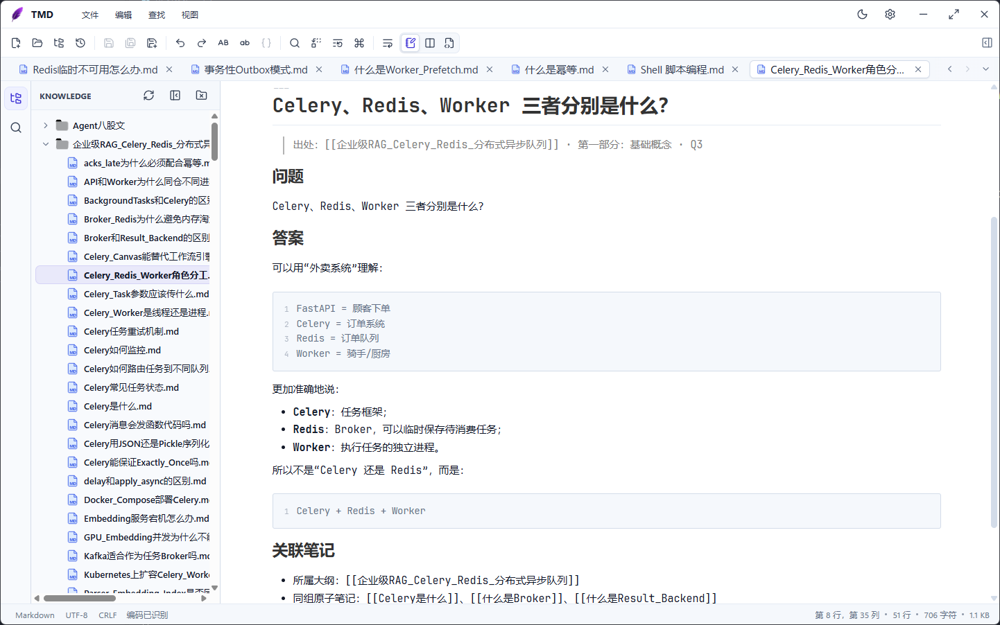

<p align="center">
  
</p>

<h1 align="center">TMD</h1>

<p align="center"><strong>一款为程序员而生的轻量级文本 & Markdown 桌面编辑器</strong></p>

<p align="center">
  
  
</p>

<p align="center">
  
  
  
  
  
  
</p>

<p align="center">
  <a href="#-features">功能特性</a> ·
  <a href="#-downloads">下载安装</a> ·
  <a href="#-development">本地开发</a> ·
  <a href="#-project-structure">项目结构</a> ·
  <a href="#-credits">开源与致谢</a>
</p>

---

<p align="center">
  
</p>

## ✨ Features

TMD 基于 **Tauri 2 + Rust** 构建，后端核心用 Rust 编写（内存映射、并行文件遍历），前端使用 **Monaco**（VS Code 同款编辑内核）与 **Muya**（MarkText 的 WYSIWYG Markdown 引擎）。界面遵循程序员审美：自绘标题栏、紧凑工具栏、低饱和配色。

**📁 文件与工作区**
- 单文件 / 文件夹（工作区）双模式，支持拖放打开、多标签编辑、最近打开
- 工作区目录树、文件重命名、标签批量管理（关闭其他 / 右侧 / 已保存）

**📝 编辑内核**
- Monaco 内核：多语言语法高亮、JSON 智能提示、多光标、代码折叠、括号匹配、缩略图（Minimap）
- 大文件 / 长文档延迟初始化，打开迅速、内存友好
- 文档格式化（JSON / SQL，`Shift+Alt+F`）、大小写转换、跳转行（`Ctrl+G`）、命令面板（`Ctrl+P`）

**📄 Markdown**
- 即时编辑（WYSIWYG）/ 分屏预览 / 源码三种模式，可拖动调整分屏宽度
- 大纲导航、表格、任务列表、数学公式、网络图片
- Mermaid、PlantUML、Vega 图表渲染

**🔍 查找与替换**
- 当前文件悬浮查找卡：大小写 / 全词 / 正则、搜索历史、逐个或全部替换
- 全文档与工作区搜索替换（`Ctrl+Shift+F` / `Ctrl+Shift+H`），右侧搜索面板带匹配预览

**🧬 编码与行尾**
- UTF-8 / UTF-8 BOM / UTF-16 / ANSI 编码自动识别与转换
- LF / CRLF / CR 行尾切换

**⌨️ 快捷键**
- 内置 VS Code / Notepad++ / 跟随模式三套键位方案
- 每条命令可单独改键，支持快捷键方案的导入 / 导出

**🎨 外观**
- 「晨光」浅色 /「夜航」深色双主题，一键切换
- 界面字体与编辑器字体独立配置（预设 + 自定义），字号、页面宽度可调
- 自动换行、空白符显示、光标平滑动画

**⚙️ 系统集成**
- 完整状态恢复：打开的标签、窗口位置、工作区、搜索历史、临时文档、编辑设置
- Windows：右键「以 TMD 打开」、默认应用候选（应用内开关，安装器不改动系统关联）
- 内置自动更新：后台下载新版，一键安装

## 📦 Downloads

从 [GitHub Releases](https://github.com/TP-mimanchi/TMD/releases) 下载最新稳定版：

| 平台 | 架构 | 文件 |
| --- | --- | --- |
| Windows | x64 | `TMD_Setup_<version>_x64.exe` |
| macOS | Apple Silicon（M1 ~ M4） | `TMD_<version>_aarch64.dmg` |
| Linux | x64 | `TMD_<version>_amd64.AppImage` / `.deb` |

### 🪟 Windows

双击 `.exe` 安装包按提示安装即可。安装和升级**不会**自动关联文件扩展名；如需右键「以 TMD 打开」或设为默认应用，在应用内 **设置 → 系统集成** 中开启。

### 🍎 macOS

打开 `.dmg`，把 `TMD` 拖入「应用程序」。当前版本未做 Apple Developer ID 签名与公证，首次启动时 Gatekeeper 会拦截，任选其一绕过：

- Finder 中**右键 → 打开** → 在弹窗中确认打开
- 或终端执行：

  ```bash
  xattr -dr com.apple.quarantine /Applications/TMD.app
  open /Applications/TMD.app
  ```

> 仅支持 Apple Silicon 芯片（M1 ~ M4）。Intel Mac 暂无构建，可在 [Issues](https://github.com/TP-mimanchi/TMD/issues) 中提出需求。

## 🛠 Development

### 环境依赖

- [Rust](https://rustup.rs) stable
- [Node.js](https://nodejs.org) ≥ 20.19（含 npm ≥ 8）
- Windows 额外需要 [WebView2 Runtime](https://developer.microsoft.com/microsoft-edge/webview2/)（macOS / Linux 无需）

### 启动开发模式

```bash
cd crates/tmd-app/frontend
npm install

cd crates/tmd-app
cargo tauri dev
```

### 构建安装包

```bash
cd crates/tmd-app
cargo tauri build
```
产物位于 `target/release/bundle`。`tauri.conf.json` 开启了 `createUpdaterArtifacts`（自动更新），构建时必须提供更新签名密钥，否则报 `no Tauri private key provided`：

> Tauri CLI 会自动在 `crates/tmd-app/frontend` 下执行 `npm run dev` / `npm run build`，因此在仓库任意目录调用 `cargo tauri` 均可。


### 验证

```bash
cargo test --workspace

cd crates/tmd-app/frontend
npm run test:keybindings
npm run build
```

## 📂 Project Structure

```text
crates/tmd-app/            Tauri 桌面应用（窗口、命令、系统集成、更新）
crates/tmd-app/frontend/   前端界面（Monaco + Muya + 设置/搜索/主题）
crates/tmd-core/           Rust 核心（文档编码、文件系统、全文搜索）
docs/                      产品、架构与性能设计文档
.github/workflows/         GitHub Actions 发布流水线
```

## 🤝 Credits

TMD 以 [MIT License](LICENSE) 开源。

Markdown 即时编辑能力基于 [MarkText](https://github.com/marktext/marktext) 的 Muya 与 [Notra](https://github.com/zhangzhibang/Notra) 编辑器演进，固定上游版本及许可证保留在 `crates/tmd-app/frontend/vendor/marktext-muya`。代码编辑能力由 [Monaco Editor](https://github.com/microsoft/monaco-editor) 提供，应用框架为 [Tauri](https://github.com/tauri-apps/tauri)。其余第三方依赖各自遵循其许可证。

---

<p align="center"><sub>MIT © 2026 TMD contributors</sub></p>
